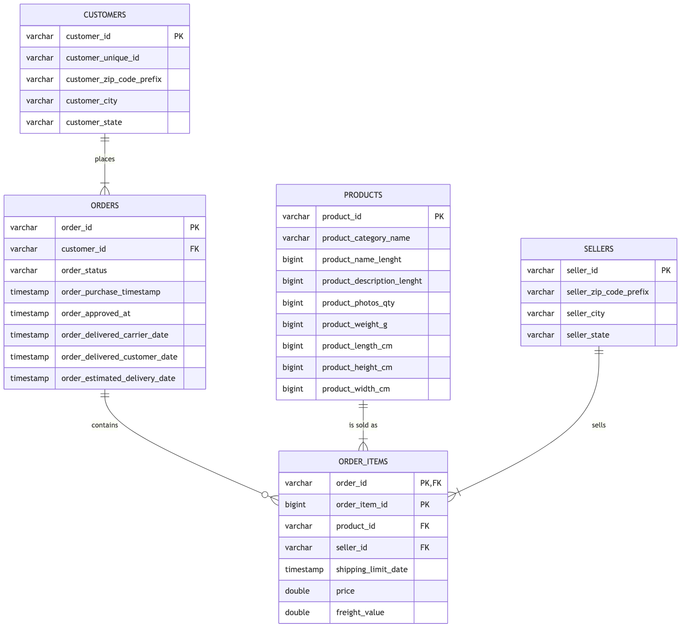
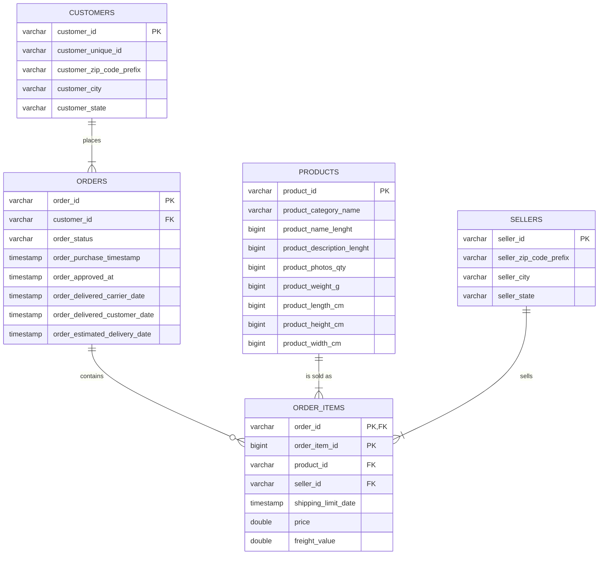

# ERD: Olist source tables

Crow's foot notation, five tables from the `raw` schema. The Mermaid source is in [`erd.mmd`](erd.mmd).
`PK, FK` on `order_items.order_id` and `PK` on `order_item_id` mark the composite primary key.

## Cardinalities (measured in `notebooks/01_explore_source_data.ipynb`, section 6)

| relationship | parent side | child rows per parent (min / max) | child side drawn |
|---|---|---|---|
| customers **places** orders | exactly one (FK non-null, 0 orphans) | 1 / 1 | one or many |
| orders **contains** order_items | exactly one (FK non-null, 0 orphans) | 0 / 21 (775 orders have no items) | zero or many |
| products **is sold as** order_items | exactly one (FK non-null, 0 orphans) | 1 / 527 | one or many |
| sellers **sells** order_items | exactly one (FK non-null, 0 orphans) | 1 / 2033 | one or many |
